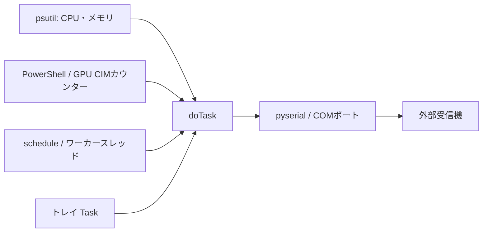

# パフォーマンスモニター PCソフト
更新日: 2026-11-17

## 目次
- [概要](#概要)
- [構成](#構成)
- [準備と起動](#準備と起動)
- [通信仕様](#通信仕様)
- [exeのビルドと配布](#exeのビルドと配布)
- [運用と障害対応](#運用と障害対応)
- [検証](#検証)
- [管理資料](#管理資料)

## 概要
WindowsのCPU・メモリ・GPU使用率を取得し、COMポートへASCII文字列として送信する。システムトレイで動作し、Taskで追加送信、Exitで終了する。外部APIやデータベースは使用しない。

## 構成
| ファイル | 役割 |
| --- | --- |
| SendPerformance.py | 指標取得、シリアル送信、トレイ、起動引数 |
| icon.png | トレイ画像。スクリプトと同じ場所から読み込む |
| Build.bat | Nuitka standaloneビルド |
| requirements-build.txt | Nuitka 4.3.5の指定 |
| doc/ | 要件・構成・決定・タスク |
| dist/SendPerformance.dist/ | ビルド時の配布フォルダ |



## 準備と起動
Windows、Python、利用可能なCOMポート、Windows PowerShellを使用する。現在の仮想環境の設定はPython 3.10.6を示すが、対応バージョン範囲は未確認。

新規環境の準備例:
```powershell
py -3.10 -m venv .venv
.\.venv\Scripts\python.exe -m pip install pystray Pillow schedule psutil pyserial
.\.venv\Scripts\python.exe -m pip install -r requirements-build.txt
```
実行時依存のバージョン固定ファイルは現状存在しない。上記はソースのimportに基づく準備手順であり、新規環境での再現性は未確認。

```powershell
.\.venv\Scripts\python.exe SendPerformance.py
.\.venv\Scripts\python.exe SendPerformance.py --port COM15 --baudrate 115200
```

| 引数 | 既定値 | 説明 |
| --- | --- | --- |
| --port | COM15 | 送信先。受信機に割り当てられたポートを指定する |
| --baudrate | 115200 | 通信速度。受信側と一致させる |
| --help | なし | ヘルプを表示して終了する |

## 通信仕様
- フィールド順はCPU使用率、メモリ使用率、GPU使用率。単位は%。
- カンマ区切り、ヘッダーなし、空行なし、ASCII、行末CRLF（0x0D 0x0A）。
- 例: `12.5,34.5,0\r\n`。ここで `\r\n` は実際の改行バイトを表す。
- シリアル設定はpyserial既定の8データビット・パリティなし・1ストップビット・フロー制御なし。書き込みタイムアウトは1秒。
- CPUは0.5秒の測定、メモリはvirtual_memory().percentを使用する。
- GPUはプロセスごとのGPUエンジン使用率を同一エンジン単位で合計し、その最大値を0～100に制限する。複数GPU全体の平均値ではない。
- GPU取得のOSエラー・サブプロセスエラー・数値変換エラーでは0を送る。PowerShellの待機上限は5秒。
- スケジュール登録間隔は0.1秒、待機ループは0.1秒。測定・PowerShell起動・送信に時間がかかるため、実送信間隔は0.1秒固定ではない。ソース内の「5秒毎」というコメントとは異なる。

## exeのビルドと配布
```powershell
.\.venv\Scripts\python.exe -m pip install -r requirements-build.txt
.\Build.bat
```

| オプション | 設定 |
| --- | --- |
| --mode=standalone | 依存ファイルを含む配布フォルダを生成 |
| --windows-console-mode=attach | 既存コンソールへの接続 |
| --include-module=pystray._win32 | Windowsトレイ実装を含める |
| --include-data-files=icon.png=icon.png | PNG画像を同梱 |
| --output-dir=dist | 出力先 |
| --assume-yes-for-downloads | 必要なツールのダウンロード確認を自動承諾 |

ビルド環境にはNuitka対応のCコンパイラと、キャッシュへの書き込み権限が必要。初回はツール取得のためネットワーク接続が必要になる場合がある。

`dist\SendPerformance.dist\SendPerformance.exe` を起動する。配布・バックアップは **SendPerformance.distフォルダ全体** を対象とし、exeだけを抜き出さない。配布先にもCOM機器・ドライバー・PowerShellが必要。VC++ランタイムの同梱状況と配布先への導入要否は、ビルドログと配布先で確認する。

## 運用と障害対応
| 操作・症状 | 対応・現行の挙動 |
| --- | --- |
| 停止 | トレイのExit。ワーカー終了を待ち、COMポートを閉じる |
| GPUが常に0 | 使用率0と取得失敗を区別する仕組みはない。CIMカウンター・権限を確認する |
| 起動時にポートを開けない | ポート名、機器接続、他ソフトの占有を確認する。自動復旧はない |
| 動作中の送信失敗 | シリアル例外は捕捉しない。定期実行スレッドが停止する場合がある。原因を除去して再起動する |
| 画像読み込み失敗 | スクリプトまたは配布先のicon.pngを確認する |
| ログ | ログファイル機能はない。端末から起動して例外出力を確認する |
| 復旧 | 保管した配布フォルダ全体を戻す。保存データ・設定ファイルはないため、起動引数を別途記録する |

## 検証
2026-11-17に次を実行し、成功した。
```powershell
.\.venv\Scripts\python.exe SendPerformance.py --help
.\.venv\Scripts\python.exe -m pip check
.\.venv\Scripts\python.exe -c "import ast; from pathlib import Path; ast.parse(Path('SendPerformance.py').read_text(encoding='utf-8')); print('Python syntax OK')"
```
test/test_send_performance.pyに開発側で実行できるテストを配置した。実装時に次を実行する。

```powershell
.\.venv\Scripts\python.exe -W error::ResourceWarning -m unittest discover -s test -v
```

2026-11-17に14件すべて成功した。追加依存はなく、unittestと既存依存を使用する。

| 検証対象 | 確認方法 |
| --- | --- |
| 送信形式 | loop://でCPU・メモリ・GPUの順序、ASCII、カンマ、CRLF、GPU取得失敗時0を確認 |
| GPU | 結果差し替えで数値・上下限・不正値・OSエラー・終了エラー・タイムアウトを確認 |
| GPU集計 | 実PowerShellでCIM問い合わせだけを固定データに差し替え、同一エンジンの合計と最大値選択を確認 |
| Task・Exit | GUIをモック化し、実MenuItemのコールバック、通常終了・例外時のワーカー待機とポートcloseを確認 |
| 定期処理 | 独立Schedulerとスレッドでタスク呼び出しを確認 |
| 既存exe | PNGのバイト一致、別フォルダでの--help、無効ポート指定時の画像読み込み後の接続処理到達を確認 |

exe未作成なら関連3件をスキップする。必要ならBuild.batで作成して再実行する。既存exeのテストは再ビルド成功や最新ソースとの一致を保証しない。
今回、実機COMポート・GPU実測・実GUI・配布先は検証していない。利用者確認T-004・T-005の完了報告とは区別する。詳細は[タスク管理](doc/tasks.md)を参照する。

## 管理資料
- [要件](doc/requirements.md)
- [構成・設計](doc/architecture.md)
- [決定記録](doc/decisions.md)
- [タスク管理](doc/tasks.md)