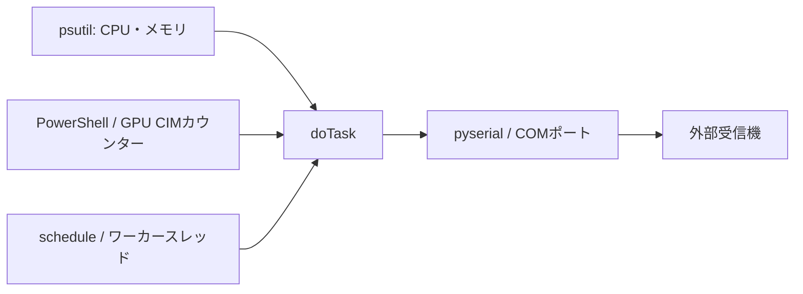

# パフォーマンスモニター PCソフト
更新日: 2026-11-17

## 目次
- [概要](#概要)
- [構成](#構成)
- [準備と起動](#準備と起動)
- [出力設定](#出力設定)
- [通信仕様](#通信仕様)
- [exeのビルドと配布](#exeのビルドと配布)
- [運用と障害対応](#運用と障害対応)
- [検証](#検証)
- [管理資料](#管理資料)

## 概要
WindowsのCPU・メモリ・GPU使用率を取得し、COMポートへASCII文字列として送信する。システムトレイで動作し、起動後に自動送信し、Configで出力設定、Exitで終了する。外部APIやデータベースは使用しない。

## 構成
| ファイル | 役割 |
| --- | --- |
| SendPerformance.py | 指標取得、シリアル送信、トレイ、起動引数 |
| src/config_dialog.py | TkinterによるConfig画面とメインループ |
| src/disk_diagnostics.py | COM接続なしの診断 |
| src/__init__.py | 補助モジュールのパッケージ |
| src/settings.py | setting.jsonの保存・復元と保存先解決 |
| icon.png | トレイ画像。スクリプトと同じ場所から読み込む |
| Start.bat | Python版を起動し、引数と終了コードを引き継ぐ |
| Build.bat | Nuitka standaloneビルド |
| Package.bat | ビルド済み配布フォルダ全体をZIP化 |
| requirements.txt | 実行時の直接依存とバージョン |
| requirements-build.txt | Nuitka 4.3.5の指定 |
| doc/ | 要件・構成・決定・タスク |
| dist/SendPerformance.dist/ | ビルド時の配布フォルダ |



## 準備と起動
Windows、Python、利用可能なCOMポート、Windows PowerShellを使用する。現在の仮想環境の設定はPython 3.10.6を示すが、対応バージョン範囲は未確認。

新規環境の準備例:
```powershell
py -3.10 -m venv .venv
.\.venv\Scripts\python.exe -m pip install -r requirements.txt
.\.venv\Scripts\python.exe -m pip install -r requirements-build.txt
```
requirements.txtには現在の仮想環境で使用する実行時の直接依存5件をバージョン固定で記載する。推移的依存を含む完全なロックファイルではない。新規環境での再構築は未確認。

```powershell
.\.venv\Scripts\python.exe SendPerformance.py
.\.venv\Scripts\python.exe SendPerformance.py --port COM15 --baudrate 115200
```

| 引数 | 既定値 | 説明 |
| --- | --- | --- |
| --port | 保存済みport、未設定時COM15 | 指定すると保存済みポートを上書きして起動する |
| --baudrate | 115200 | 通信速度。受信側と一致させる |
| --help | なし | ヘルプを表示して終了する |

Start.batからも起動できる。バッチ自身のフォルダへ移動し、.venvのPythonを優先する。.venvがなければPATHのpythonを使う。引数はそのままメインへ渡し、異常終了時はメッセージと一時停止でエラーを確認できる。

```powershell
.\Start.bat
.\Start.bat --port COM15 --baudrate 115200
.\Start.bat --help
```

## 出力設定
1. トレイアイコンを右クリックし、Configを選択する。
2. 出力1・出力2・出力3のプルダウンでCPU・メモリ・GPU・ディスクのアクティブ時間を選ぶ。順序変更と重複を許可する。
3. 「適用」で設定を反映する。「キャンセル」または×で閉じると変更しない。

初期値はCPU・メモリ・GPU。「適用」で3枠の設定をsetting.jsonに保存し、次回起動時に復元する。exeではexeと同じフォルダ、Python実行ではSendPerformance.pyと同じフォルダを使い、作業フォルダに依存しない。COMポートもConfigで選択・手入力でき、setting.jsonのportへ保存する。通信速度は引き続き--baudrateで指定する。

```json
{
  "outputs": ["CPU", "メモリ", "ディスクのアクティブ時間"],
  "port": "COM15"
}
```

setting.jsonがなければ初期値で起動し、最初の適用で作成する。JSONの破損・不正な指標・読み取り失敗では警告を記録して初期値を使う。読み取り時に元ファイルを上書きしない。
保存は同じフォルダ内の一時ファイルから置き換える。保存先への書き込み権限が必要。保存に失敗すると画面にエラーを表示し、画面を閉じず、変更前の設定を維持する。キャンセル・×では保存しない。
COMポート欄は一覧を開くたびに接続中の候補を再取得する。COM9のように手入力もできる。portのない旧JSONはCOM15として読み込む。--portの指定があれば保存値より優先する。

適用時は新しいポートを開き、保存に成功してから接続と出力設定を一括変更する。開けないポートや保存エラーでは元の接続・設定を維持する。同じ開いているポートは開き直さない。

設定画面は1つだけ表示し、再度Configを選ぶと前面へ出す。画面表示中も定期送信を継続する。適用時に計測中だった行は変更前の設定で送信され、次の計測から変更後の設定となる。

### ディスクのアクティブ時間
Configで「ディスクのアクティブ時間」を選ぶと、物理ディスクのアクティブ時間（0～100%）を送信する。
WindowsのWin32_PerfFormattedData_PerfDisk_PhysicalDiskから各ディスクのPercentIdleTimeを取得し、100から引いた値の最大を使用する。_Totalは除外する。対象はドライブ文字単位ではなく物理ディスクである。
この項目が選択されている場合のみ1回取得し、重複枠にも同じ値を使う。取得不能・カウンターなし・不正値・5秒のタイムアウトでは0を返す。取得失敗の0と実測0は区別しない。
処理にはPowerShellの追加起動・CIM問い合わせ時間がかかるため、送信周期は長くなる場合がある。ディスク容量使用率や転送速度ではない。

カウンターの定義は[Microsoft公式資料](https://learn.microsoft.com/ja-jp/previous-versions/aa394262(v=vs.85))を参照する。

## 通信仕様
- フィールド順の初期値はCPU使用率、メモリ使用率、GPU使用率。Configで各枠を変更できる。常に3列で単位は%。
- カンマ区切り、ヘッダーなし、空行なし、ASCII、行末CRLF（0x0D 0x0A）。
- 例: `12.5,34.5,0\r\n`。ここで `\r\n` は実際の改行バイトを表す。
- シリアル設定はpyserial既定の8データビット・パリティなし・1ストップビット・フロー制御なし。書き込みタイムアウトは1秒。
- CPUは0.5秒の測定、メモリはvirtual_memory().percentを使用する。
- GPUはプロセスごとのGPUエンジン使用率を同一エンジン単位で合計し、その最大値を0～100に制限する。複数GPU全体の平均値ではない。
- GPU取得のOSエラー・サブプロセスエラー・数値変換エラーでは0を送る。PowerShellの待機上限は5秒。
- スケジュール登録間隔は0.1秒、待機ループは0.1秒。測定・PowerShell起動・送信に時間がかかるため、実送信間隔は0.1秒固定ではない。ソース内の「5秒毎」というコメントとは異なる。

## exeのビルドと配布
```powershell
.\.venv\Scripts\python.exe -m pip install -r requirements-build.txt
.\Build.bat
```

| オプション | 設定 |
| --- | --- |
| --mode=standalone | 依存ファイルを含む配布フォルダを生成 |
| --windows-console-mode=attach | 既存コンソールへの接続 |
| --include-module=pystray._win32 | Windowsトレイ実装を含める |
| --enable-plugin=tk-inter | Tkinter・Tcl/Tkを同梱する |
| --include-data-files=icon.png=icon.png | トレイ用のPNG画像を同梱 |
| --windows-icon-from-ico=dist/SendPerformance.ico | PNGから生成したアイコンをexeに埋め込む |
| --output-dir=dist | 出力先 |
| --assume-yes-for-downloads | 必要なツールのダウンロード確認を自動承諾 |

Build.batは既存のPillowでicon.pngからdist/SendPerformance.icoを生成する。16・24・32・48・64・128・256pxを指定し、exeへ埋め込む。PNGを更新した場合はBuild.batで再生成・再ビルドする。トレイ画像も引き続きicon.pngを使用する。

ビルド環境にはNuitka対応のCコンパイラと、キャッシュへの書き込み権限が必要。初回はツール取得のためネットワーク接続が必要になる場合がある。

`dist\SendPerformance.dist\SendPerformance.exe` を起動する。配布・バックアップは **SendPerformance.distフォルダ全体** を対象とし、exeだけを抜き出さない。配布先にもCOM機器・ドライバー・PowerShellが必要。VC++ランタイムの同梱状況と配布先への導入要否は、ビルドログと配布先で確認する。

配布ZIPの作成:
```powershell
.\Package.bat
```
Package.batはdist/SendPerformance.dist/SendPerformance.exeの存在を確認し、フォルダ内のDLL・Tcl/Tk・画像等をすべてdist/SendPerformance.zipへ格納する。ビルドは実行しないため、最新版の配布前にはBuild.batを実行する。
ZIP内はexeを直下に置く構成で、配布先のフォルダへ全体を展開して起動する。配布フォルダ内のsetting.jsonやログが存在すれば、それらも含まれるため配布前に内容を確認する。
ZIPは一時ファイルへ作成してから既存ZIPと置き換える。作成失敗時は従来のZIPを維持し、一時ZIPを削除する。結果表示後に一時停止する。

## 運用と障害対応
| 操作・症状 | 対応・現行の挙動 |
| --- | --- |
| 停止 | トレイのExit。ワーカー終了を待ち、COMポートを閉じる |
| GPUが常に0 | 使用率0と取得失敗を区別する仕組みはない。CIMカウンター・権限を確認する |
| 起動時にポートを開けない | アプリを接続待ちで起動しConfigを表示する。接続を確認してポートを適用すると送信を開始する |
| 動作中の送信失敗 | ポートを閉じてConfigを表示する。定期処理は継続し、未接続中は測定・送信を省略する。接続を確認してConfigを適用する |
| 画像読み込み失敗 | スクリプトまたは配布先のicon.pngを確認する |
| ログ | --debug-logで任意のファイルに取得値・取得失敗・送信したCSVを記録する。通常はログを作成しない |
| 復旧 | 保管した配布フォルダ全体を戻す。setting.jsonもバックアップ・復元し、COM等の起動引数は別途記録する |

## 検証
2026-11-17に次を実行し、成功した。
```powershell
.\.venv\Scripts\python.exe SendPerformance.py --help
.\.venv\Scripts\python.exe -m pip check
.\.venv\Scripts\python.exe -c "import ast; from pathlib import Path; ast.parse(Path('SendPerformance.py').read_text(encoding='utf-8')); print('Python syntax OK')"
```
test/test_send_performance.pyに開発側で実行できるテストを配置した。実装時に次を実行する。

```powershell
.\.venv\Scripts\python.exe -W error::ResourceWarning -m unittest discover -s test -v
```

2026-11-17に14件すべて成功した。追加依存はなく、unittestと既存依存を使用する。

| 検証対象 | 確認方法 |
| --- | --- |
| 送信形式 | loop://でCPU・メモリ・GPUの順序、ASCII、カンマ、CRLF、GPU取得失敗時0を確認 |
| GPU | 結果差し替えで数値・上下限・不正値・OSエラー・終了エラー・タイムアウトを確認 |
| GPU集計 | 実PowerShellでCIM問い合わせだけを固定データに差し替え、同一エンジンの合計と最大値選択を確認 |
| Config・Exit | GUIをモック化し、実MenuItemのコールバック、通常終了・例外時のワーカー待機とポートcloseを確認 |
| 定期処理 | 独立Schedulerとスレッドでタスク呼び出しを確認 |
| 既存exe | PNGのバイト一致、別フォルダでの--help、無効ポート指定時の画像読み込み後の接続処理到達を確認 |

exe未作成、またはexeがSendPerformance.py・src配下のモジュール・Build.batより古い場合は、exeテスト群をスキップする。必要ならBuild.batで作成して再実行する。既存exeのテストは再ビルド成功や最新ソースとの一致を保証しない。
今回、実機COMポート・GPU実測・実GUI・配布先は検証していない。利用者確認T-004・T-005の完了報告とは区別する。詳細は[タスク管理](doc/tasks.md)を参照する。

### Config追加後の検証（2026-11-17）
同じunittestコマンドで23件成功。古いexeのテスト群は1グループをスキップした。出力順・重複・不正設定・計測中の一括設定変更・Config要求・Exitの停止要求を追加検証した。
設定画面はモックに加え、実Tkを非表示で起動し、プルダウン適用・再表示・メインループからの終了を確認した。当時は実トレイ・実機・再ビルドが未確認だった。後にT-008・T-009で完了報告を受領した。

### ディスクのアクティブ時間追加後の検証（2026-11-17）
同じunittestコマンドで30件成功。旧exeのテスト群は1グループをスキップした。
ディスク値の上下限、エラー・空データ時の0、複数ディスクからの最大値選択、_Total除外、ディスク重複枠の3列送信、未選択時の取得省略を確認した。実Tkのプルダウン適用もディスク候補を含めて検証した。
実機のCIMで物理ディスク0 C:・1 D:・2 F:とPercentIdleTimeの読み取りを確認した。当時はCOM実機・負荷追従・exe再ビルドが未確認だった。後にT-009・T-011で完了報告を受領した。

### T-011用のディスク負荷スクリプト
Configでいずれかの出力を「ディスクのアクティブ時間」に設定してから、別のPowerShellで実行する。

```powershell
.\.venv\Scripts\python.exe test/disk_load.py --directory "$env:TEMP" --seconds 30
```

| 引数 | 既定値 | 意味 |
| --- | --- | --- |
| --directory | OSの一時フォルダ | 負荷をかける物理ディスク上の既存フォルダ |
| --seconds | 30 | 処理時間の上限（0より大きく3600秒以下） |
| --size-mib | 128 | 一時ファイルのサイズ上限（1～4096MiB） |
| --max-write-mib | 1024 | 初期化を含む累積書き込み上限（size-mib以上、65536MiB以下） |

時間または累積書き込み上限に達したら終了する。Ctrl+Cでも停止できる。処理時間の上限はI/O間で確認するため、実行中のI/O完了や後片付けの分だけ超過する場合がある。
専用の一時ファイルを排他的に作成して初期化し、64KiB単位のランダム読み書きを行う。書き込みごとにfsyncでOSへ同期する。正常終了・Ctrl+C・I/O例外時に作成したファイルを削除する。プロセス強制終了や電源断ではファイルが残る場合がある。
空き容量は一時ファイル上限に加えて64MiBを必要とする。既存ファイルは読み書きしない。Python標準ライブラリだけで実行でき、COMポートは開かない。

負荷前・負荷中・負荷停止後で、タスクマネージャーの対象物理ディスクと受信値の変化を確認する。アプリは全物理ディスクの最大値を送るため、別ディスクの負荷も影響する。
OSやデバイスのキャッシュにより読み込みは物理I/Oにならないことがあり、100%到達は保証しない。累積上限ですぐ終了する場合は--max-write-mibを明示的に増やす。OneDrive同期対象外のフォルダを指定すると、同期処理の影響を抑えて確認できる。

スクリプトの自動テスト:
```powershell
.\.venv\Scripts\python.exe -B -m unittest discover -s test -p test_disk_load.py -v
```
2026-11-17に5件成功。最大2MiB・0.5秒のCLI動作確認も成功し、一時ファイルの削除を確認した。長時間負荷・COM受信での追従はT-011で確認する。

### ディスク値が負荷に追従しない場合
COM接続せず、実行しているexe自身の取得値とCSV生成を確認する診断モードを用意している。

```powershell
.\dist\SendPerformance.dist\SendPerformance.exe --diagnose-disk --debug-log disk-diagnostic.log
```

CPU・メモリ・ディスクの順で5回取得し、実シリアルポートを開かずloop://で送受信する。3列目がディスク値。Configは表示しない。負荷中に実行する。
通常動作の送信内容を記録する場合:
```powershell
.\dist\SendPerformance.dist\SendPerformance.exe --port COM15 --debug-log telemetry.log
```
Configで出力3を「ディスクのアクティブ時間」にして「適用」する。ログのoutputsとTXで設定と送信値、disk rawで取得値、disk acquisition failedで取得失敗を確認できる。
取得は同期処理で、実測では1行に約2秒かかった。負荷停止後の計測や短時間のピークはタスクマネージャーの瞬時表示と一致しない場合がある。GPU取得処理も実行する。
診断モードで80前後・通常TXの3列目も80前後なら受信・表示側を、disk acquisition failedなら権限・カウンター・タイムアウトを、outputsが想定と違うなら適用操作・起動中の版を確認する。

診断機能追加後の検証（2026-11-17）: Build.batでexe再ビルド成功。最大64MiB・8秒の一時負荷でexe診断CSVの3列目が82・81・81%、負荷停止後1%となった。実書き込みは約43.6MiB。一時ファイルは削除済み。自動テスト40件成功、スキップなし。同日、利用者より最新ビルドで正常動作するとの報告を受領し、T-011・T-013を完了とした。ビルド前のexeを検証していた可能性はあるが、根本原因としては未確定である。

### srcへの移動後の検証（2026-11-17）
SendPerformance.pyをルートに残し、補助モジュールをsrcパッケージへ移動した。テスト・負荷スクリプトはtest/に維持する。
起動・ビルドの入口は変わらず、Build.batはSendPerformance.pyから静的importをたどって補助モジュールを取り込む構成である。
自動テスト37件とSendPerformance.py --helpが成功した。旧exeのテスト群は1グループをスキップ。移動後のexeは未再ビルド。

### 設定保存追加後の検証（2026-11-17）
同じunittestコマンドで48件成功、旧exeのテスト群は1グループスキップ。保存と再起動復元、日本語・順序・重複、Python/Nuitka/frozenの保存先、欠損・破損JSON、置換失敗時の旧ファイル保持・一時ファイル削除、GUIでの保存失敗を検証した。Pythonでの保存先は利用者確認済み。exeではdist/直下に生成される報告があり、起動exeのsys.argv[0]を基準とするよう修正した。2026-11-17、利用者からT-019完了の報告を受領。修正後exeでの保存先・再起動復元・キャンセル・保存失敗時の確認は完了済み。

### exeアイコン追加後の検証（2026-11-17）
Build.batで再ビルド成功。icon.pngから生成した7サイズのアイコンをexeへ埋め込んだ。
test/test_executable_icon.pyでICOの複数サイズとWindows APIによるexeアイコンリソースを確認し、全53件成功、スキップなし。
2026-11-17、利用者からT-022完了の報告を受領し、エクスプローラー上のexeアイコン表示を確認済み。

### 起動・配布バッチの検証（2026-11-17）
test/test_batch_scripts.pyの6件が成功した。別作業フォルダ、日本語・空白パス、引数、終了コード、ZIP全体格納・既存ZIP更新・失敗時の維持と一時ファイル削除を確認した。
実Package.batでもZIPを生成し、948ファイルの一致とCRCを検証した。Start.batは実プロジェクトの--helpで確認し、COMを使う通常起動は実施していない。

### COM設定追加後の検証（2026-11-17）
ConfigにCOMポート選択欄を追加し、portの保存・起動時復元・引数の優先を実装した。
自動テスト70件成功、旧exeのテスト群は1グループスキップ。接続切替、使用中ポート、保存失敗、未接続起動、送信失敗後のConfig要求、旧JSONとの互換性を検証した。実TkのCOM欄適用も非表示で確認した。
実機ポートの切り替えと再ビルド後exeは利用者確認待ち。

## 管理資料
- [要件](doc/requirements.md)
- [構成・設計](doc/architecture.md)
- [決定記録](doc/decisions.md)
- [タスク管理](doc/tasks.md)