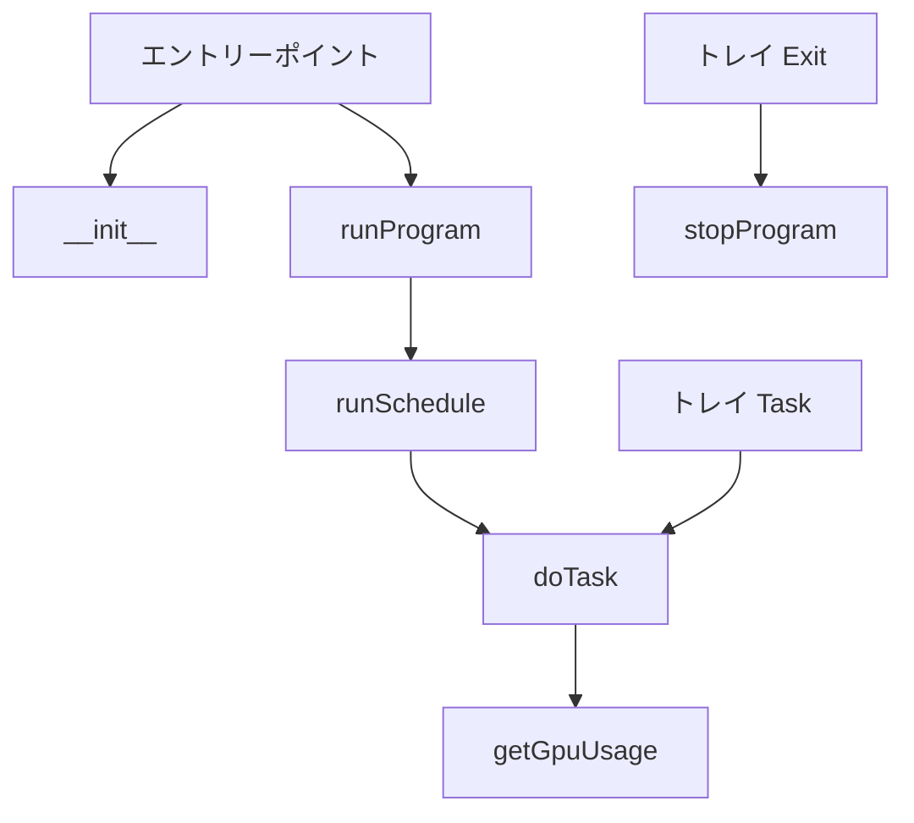
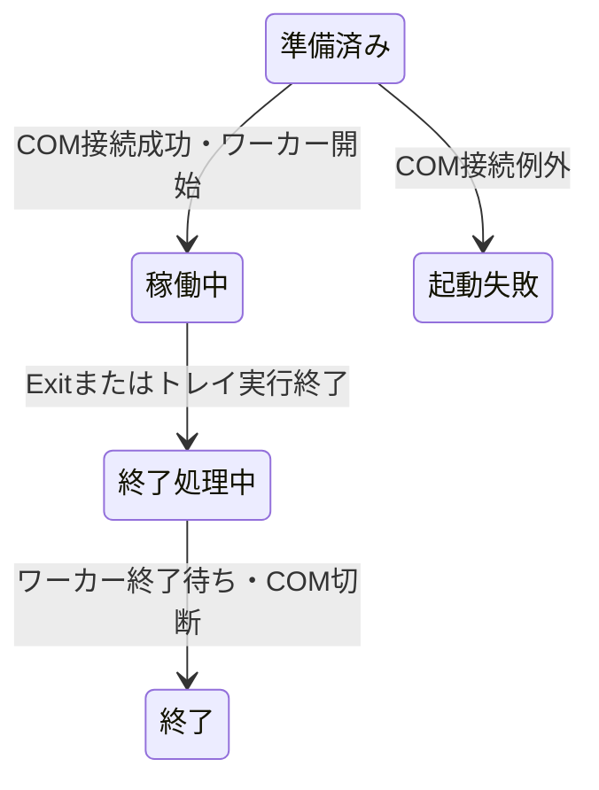

# 構成・設計
更新日: 2026-11-17

## 目次
- [全体構成](#全体構成)
- [モジュールの役割](#モジュールの役割)
- [データ・保存形式](#データ保存形式)
- [主要な処理](#主要な処理)
- [外部依存](#外部依存)
- [制約](#制約)

## 全体構成
単一のSendPerformanceクラスがトレイと指標送信を管理する。メインスレッドが非表示のTkルートとConfig画面を管理し、pystrayはrun_detachedで起動する。定期送信は別スレッドのscheduleで実行する。トレイからはEventで画面表示・終了を要求し、Tk操作はメインスレッドに限定する。継承はない。構成図は[README](../README.md#構成)を参照する。

## モジュールの役割
| 要素 | 役割 |
| --- | --- |
| SendPerformance.py | エントリーポイントとSendPerformanceクラス |
| status | 定期実行継続フラグ |
| serial | 未接続状態で生成し、runProgramで開くSerialオブジェクト |
| serial_lock | Taskと定期処理のシリアル書き込みを直列化 |
| icon | pystrayのトレイオブジェクト |
| config_dialog.py | run_config_loopで表示要求を処理し、show_output_configで3つのComboboxを表示 |
| outputs | 3つの指標名を保持するtuple。初期値はCPU・メモリ・GPU |
| config_stop / config_requested | 終了要求・表示または前面化要求をスレッド間で渡すEvent |
| Build.bat | .venvのPythonからNuitkaを実行。tk-interプラグインでTcl/Tkを同梱 |
| requirements-build.txt | Nuitka==4.3.5 |
| icon.png | PILで開くトレイ用画像 |

## データ・保存形式
送信はASCIIの3数値、カンマ区切り、行末CRLF。初期順序はCPU・メモリ・GPU。Configで3枠を選択でき、重複を許可する。永続データ、DB、設定ファイルは存在しない。起動引数はプロセス内だけで使用する。

## 主要な処理
| メソッド | 引数・戻り値 | 処理・副作用・主な例外 |
| --- | --- | --- |
| __init__ | image, port=COM15, baudrate=115200 / None | Serial・ロック・画像・メニューを準備。画像読み込み等の例外は伝播 |
| doTask | なし / None | CPU・メモリ・GPU取得、計測開始前にロック内で設定を取得し、3列を組み立ててロック内でwrite。SerialException等は伝播 |
| setOutputs | outputs / None | 指標名3個を検証し、ロック内で一括反映。不正値はValueError |
| getOutputs | なし / tuple | ロック内で現設定を返す |
| showConfig | なし / None | Eventで表示要求。表示中は前面化。終了要求後は無視 |
| getGpuUsage | なし / 数値 | PowerShellを最大5秒待機。合計したエンジン使用率の最大を0～100に制限。OSError、SubprocessError、ValueErrorを0へ変換 |
| runSchedule | なし / None | 0.1秒間隔のジョブをグローバルscheduleへ登録しrun_pendingを実行。doTask例外は捕捉しない |
| stopProgram | icon / None | status=False、Config終了要求、トレイ停止 |
| runProgram | なし / None | COM接続、ワーカー開始、トレイをrun_detachedで開始してTkループを実行。finallyでConfig停止要求、ワーカーjoin、トレイ停止、ポートclose |

起動引数を解析し、スクリプトと同じ場所のicon.pngを渡してrunProgramを呼ぶ。

状態一覧は「準備済み」「稼働中」「終了処理中」「終了」「起動失敗」とする。送信スレッド単体の異常停止はstatusで表現されない。

既存の主要6メソッドでは引数・戻り値・例外を説明するdocstringが未整備。追加した設定関連処理には要旨のdocstringを付けた。コメントの一部は実装のスケジュール間隔と不一致。

## 外部依存
| 依存 | 用途 |
| --- | --- |
| tkinter / ttk（Python付属） | Config画面。pip依存の追加なし |
| pystray | Windowsトレイ |
| Pillow | PNG読み込み |
| schedule | 定期実行 |
| psutil | CPU・メモリ |
| pyserial | シリアル送信 |
| Windows PowerShell / GPU CIMカウンター | GPUエンジン情報 |
| Nuitka・Cコンパイラ | exe生成時のみ |

## 制約
- Windows固有のPowerShellとCREATE_NO_WINDOWを使用する。
- 計測・PowerShell起動は同期処理で、固定周期や即時終了を保証しない。
- ロック対象はwriteだけであり、指標取得は同時実行され得る。
- 起動時のCOM接続とワーカー開始はトレイのtry/finallyより前にある。
- シリアル切断の自動再接続やジョブ解除はなく、1プロセスでの再実行・複数インスタンス管理は未整備。
- 設計変更案の採否は[決定記録](decisions.md)で扱い、現行実装と区別する。